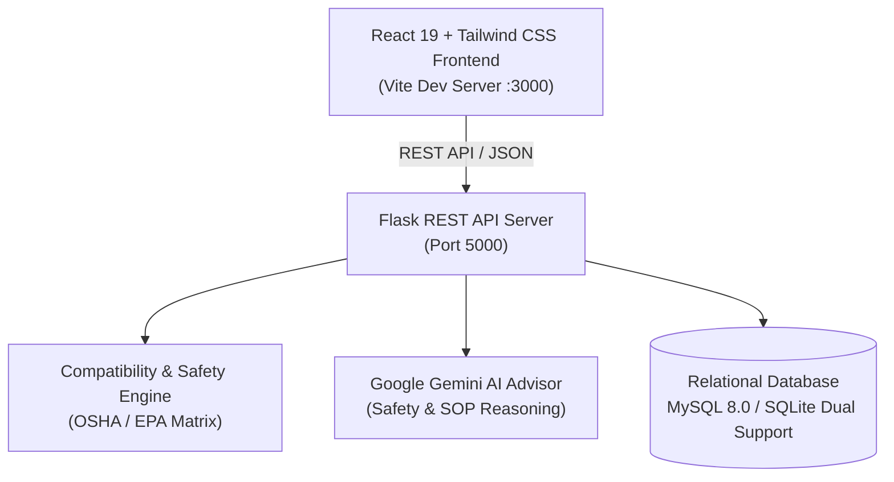
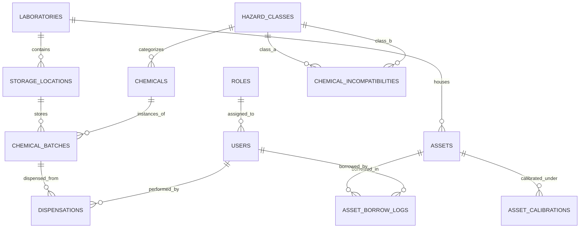

# Intelligent Laboratory Asset & Chemical Tracking Platform

[](https://pes.edu)
[](https://python.org)
[](https://flask.palletsprojects.com/)
[](https://react.dev)
[](https://tailwindcss.com)
[](https://mysql.com)
[-10B981.svg)]()

> **PES University — Department of Computer Science and Engineering**  
> **Course Project**: Full Stack Database & Web Technologies / Laboratory Management  
> **Authors**:
> - **Pranav Swaroop S** — `PES2UG24CS365`
> - **Pranav Kaushal J** — `PES2UG24CS363`

---

## 🌟 Executive Summary & Motivation
Modern university and industrial laboratories (chemistry, biotechnology, materials science, pharmacy) handle hazardous, volatile, and regulated chemical inventory alongside precision research instrumentation (spectrophotometers, high-speed refrigerated microcentrifuges, analytical balances, autoclaves). 

Traditional laboratories rely on manual logbooks, leading to:
1. **Critical Chemical Incompatibility Catastrophes**: Inadvertent co-location of strong mineral oxidizers (e.g., Nitric Acid) next to organic flammable solvents (e.g., Acetone, Diethyl Ether) can cause spontaneous runaway combustion or violent detonation.
2. **Untracked Reagent Degradation & Expiration**: Peroxide formation in ethers, opened hygroscopic reagents, and unknown remaining stock levels.
3. **Instrument Drift & Metrology Non-compliance**: Uncalibrated balances and spectrophotometers compromising experimental integrity.
4. **Disorganized Storage**: Difficulty identifying which shelf, cold storage refrigerator, or secondary containment cabinet holds a specific batch container.

The **Intelligent Laboratory Asset & Chemical Tracking Platform** solves these challenges by combining a 3NF normalized relational database (MySQL/SQLAlchemy) with a deterministic Chemical Incompatibility Engine, physical shelf visualizer, printable QR token labels, and a Gemini-powered AI Safety Advisor.

---

## 🚀 Key Features

### 1. ⚗️ GHS HazCom & NFPA 704 Chemical Master Registry
- Standard chemical master catalog with CAS Registry numbers, IUPAC nomenclature, molecular weights, and physical states.
- **Dynamic NFPA 704 Fire Diamond**: Scalable vector rendering of Health (blue), Flammability (red), Instability (yellow), and Special Hazard (white) ratings.
- **GHS Classification**: Visual pictogram badges for Flammables, Corrosives, Acute Toxicity, Oxidizers, and Aquatic Hazards.
- Batch/Lot container tracking with expiration countdowns and automated low-stock warnings.

### 2. 🛡️ Deterministic Chemical Incompatibility & Co-Location Engine
- Evaluates real-time pairwise chemical reactions based on OSHA and EPA segregation matrices.
- Flags dangerous co-locations:
  - **Oxidizers + Flammable Solvents**: Spontaneous combustion & explosion risk (e.g., HNO₃ + Acetone).
  - **Strong Acids + Strong Bases**: Violent exothermic neutralization and caustic splattering.
  - **Acids + Cyanides / Sulfides**: Deadly toxic gas evolution (liberates Hydrogen Cyanide gas).
- **Interactive Reaction Simulator**: Select any two compounds in the facility to simulate interaction, severity classification, and required mitigation protocols.

### 3. 🔬 Asset Lifecycle, Borrow/Return & Metrology Calibration
- Real-time status tracking for high-precision instrumentation: `available`, `in_use`, `calibration_due`, `under_maintenance`.
- **Borrow & Check-in Workflow**: Students and research scholars check out equipment with expected return time and purpose; return flow logs instrument condition and runtime hours.
- **ISO/IEC 17025 Metrology Tracking**: Records calibration dates, measured deviation drift, technician details, and accredited calibration certificate issuance.

### 4. 🗄️ Physical Cabinet & Shelf Visualizer (Digital Twin)
- 3D/2D visual tiered model of physical safety cabinets (Acid Cabinets, FM-approved Flammables Cabinets, 4°C Cold Storage, -20°C Freezers, Open Salt Racks).
- Inspect individual items on each shelf tier with volumetric fill levels.
- **1-Click Facility Audit**: Runs instant safety audit across all shelves and cabinets to verify compliance.

### 5. 💧 Volumetric Dispensations & Hazardous Waste Logging
- Log chemical dispensations per practical experiment or research protocol.
- Automatically deducts remaining volume/mass and warns when stocks cross reorder levels.
- Hazardous waste accumulation tracking (halogenated vs non-halogenated solvents, inorganic acids, heavy metals) with manifest numbers for pollution control disposal.

### 6. 🤖 Gemini AI Laboratory Safety Advisor
- Real-time conversational AI integration powered by Google Gemini.
- Context-aware answers for emergency chemical spill containment, PPE gear recommendations, safe neutralization steps, and instrument SOP troubleshooting.
- Offline deterministic expert knowledge fallback for environments without internet access.

### 7. 🏷️ QR Code Label Generation & Printing
- Generates high-density QR code tokens for container bottles, cabinet shelves, and assets.
- Integrated print mode for instant label generation.

### 8. 📜 Immutable Regulatory Security Audit Log
- Tamper-evident logging of every login, compound creation, volumetric dispensation, borrow/return, calibration, and safety alert with IP address and timestamp.
- One-click CSV audit trail export.

---

## 🏗️ Architecture & Tech Stack



- **Frontend**: React 19, Tailwind CSS 3.4, Lucide React, qrcode.react, Recharts, Vite.
- **Backend**: Python 3.11, Flask 3.1, Flask-SQLAlchemy 3.1, PyMySQL, pyjwt, python-dotenv, qrcode.
- **Database**: MySQL 8.0 (with automatic portable fallback to SQLite `lab_tracker.db` if MySQL credentials are not yet configured).

---

## 📂 Project Structure

```
intelligent-lab-tracker/
├── backend/
│   ├── app/
│   │   ├── __init__.py           # Flask factory & blueprint registration
│   │   ├── config.py             # Database & Gemini environment config
│   │   ├── models/               # SQLAlchemy 3NF models
│   │   │   └── __init__.py       # User, Chemical, Asset, Batch, Calibration, Dispensation...
│   │   ├── routes/               # Modular REST endpoints
│   │   │   ├── auth.py           # Authentication & role switching
│   │   │   ├── chemicals.py      # Chemical catalog & batches
│   │   │   ├── assets.py         # Equipment & borrow/return
│   │   │   ├── locations.py      # Cabinets, shelves, and location audits
│   │   │   ├── compatibility.py  # Pairwise reaction simulator
│   │   │   ├── dispensations.py  # Volumetric deductions & waste manifests
│   │   │   ├── maintenance.py    # Calibration schedules
│   │   │   ├── analytics.py      # Compliance index & metrics
│   │   │   └── ai_assistant.py   # Gemini safety advisor
│   │   ├── services/
│   │   │   ├── compatibility_engine.py  # Chemical segregation rules
│   │   │   ├── gemini_advisor.py        # Gemini API integration
│   │   │   └── qr_service.py            # QR code generation
│   ├── database/
│   │   ├── schema.sql            # MySQL 8.0 DDL statements
│   │   ├── seed.sql              # Rich PES University laboratory seed data
│   │   └── init_db.py            # Automated table initialization script
│   ├── run.py                    # Server launch entry point
│   ├── test_api.py               # 13/13 passing automated integration tests
│   └── requirements.txt          # Python dependency specifications
├── frontend/
│   ├── src/
│   │   ├── components/           # NFPA diamond, GHS pictograms, Shelf visualizer, modals...
│   │   ├── pages/                # Dashboard, Inventory, Equipment, Safety matrix...
│   │   ├── services/api.js       # Unified frontend API client
│   │   ├── context/AuthContext.jsx
│   │   ├── App.jsx
│   │   └── main.jsx
│   ├── package.json
│   ├── tailwind.config.js
│   └── vite.config.js
├── scripts/
│   ├── start_all.bat             # 1-Click launcher for both servers
│   ├── start_backend.bat         # Launch Flask backend
│   ├── start_frontend.bat        # Launch React frontend
│   └── setup_mysql.py            # Helper script to initialize MySQL
└── README.md
```

---

## ⚡ Quickstart Guide

### Option 1: 1-Click Launch (Recommended on Windows)
Simply double-click:
```cmd
scripts\start_all.bat
```
This automatically initializes the database, starts the Flask API on `http://127.0.0.1:5000`, and launches the React frontend on `http://localhost:3000`.

---

### Option 2: Running Components Individually

#### 1. Backend Setup:
```powershell
cd backend
python -m pip install -r requirements.txt
python database/init_db.py
python run.py
```
*Backend runs at `http://127.0.0.1:5000`*

#### 2. Frontend Setup:
```powershell
cd frontend
npm.cmd install
npm.cmd run dev
```
*Frontend runs at `http://localhost:3000`*

---

## 🧪 Automated Test Suite

To verify all 13 backend functional modules, run:
```powershell
python backend/test_api.py
```
Output:
```
============================================================
  RUNNING INTELLIGENT LAB TRACKER REST API TEST SUITE
============================================================
[PASS] 1. /api/health - API online & reporting metadata
[PASS] 2. /api/auth/login - Logged in as: Pranav Swaroop S (PES2UG24CS365)
[PASS] 3. /api/chemicals - Fetched 8 catalog chemicals with GHS/NFPA ratings
[PASS] 4. /api/chemicals?q=Acetone - Filter matched: Acetone (HPLC Grade)
[PASS] 5. /api/compatibility/check-pair - Hazard Alert: EXTREME DANGER: Nitric Acid + Organic Solvent Detonation Hazard [CRITICAL_EXPLOSION]
[PASS] 6. /api/locations/1/safety-audit - Cabinet: Main Safety Solvent Cabinet A1, Total Items: 3
[PASS] 7. /api/assets - Fetched 6 laboratory assets
[PASS] 8. /api/assets/1/borrow - Asset status transitioned to: in_use
[PASS] 9. /api/assets/1/return - Returned asset status: available
[PASS] 10. /api/dispensations - Successfully deducted 25.0 ml (New balance: 1825.0 ml)
[PASS] 11. /api/assets/3/calibrate - Micro-balance calibration recorded successfully. Status: available
[PASS] 12. /api/ai/safety-advisor - Received guidance from: Gemini Safety Intelligence
[PASS] 13. /api/analytics/dashboard - Compliance Score: 82% (Grade: A)

============================================================
  ALL 13 API TEST CASES PASSED SUCCESSFULLY (100%)!
============================================================
```

---

## 🗄️ Database Schema & Relational Design

The database adheres strictly to Third Normal Form (3NF) relational design:



---

## 👥 Authors & Academic Credits
- **Pranav Swaroop S** (`PES2UG24CS365`) — Full Stack Integration, Compatibility Safety Engine & Architecture
- **Pranav Kaushal J** (`PES2UG24CS363`) — Relational Database Modeling, Metrology Calibration & Asset Management
- **PES University** — Electronic City Campus, Bangalore, India
